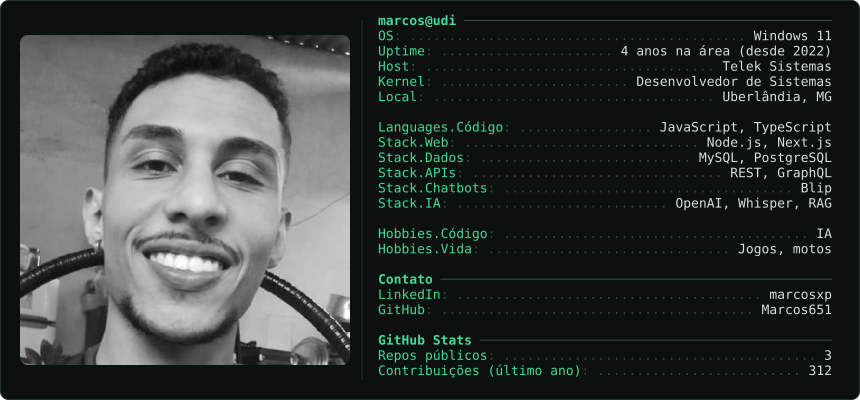
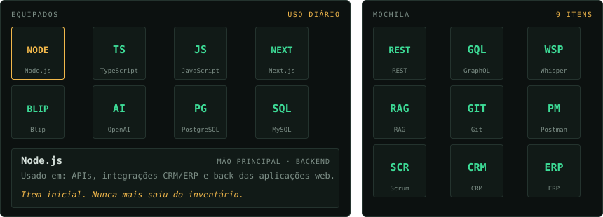
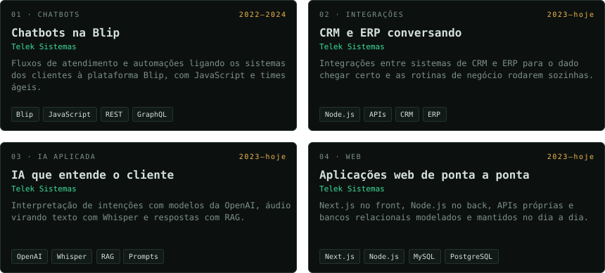
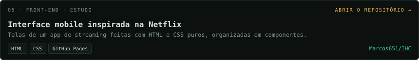
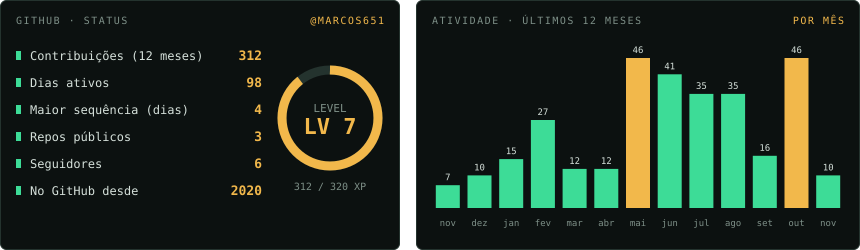
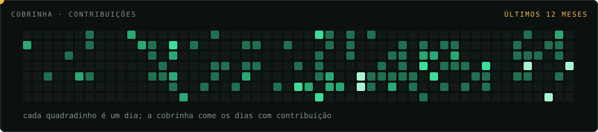

  

### `$ whoami`

  

### `$ inventory --equipped`

  

### `$ ls ~/projects`

  

  

### `$ gh status`

  

  

### `$ ping marcos`

Quer trocar ideia sobre bots, integrações ou IA? Me chama no [LinkedIn](https://www.linkedin.com/in/marcosxp/).
